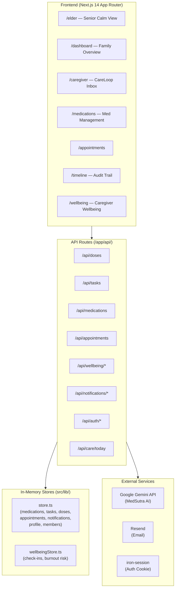

# 🏗️ Guardian Oasis — Architecture

## Module Diagram



---

## Tech Stack

| Layer | Technology |
|---|---|
| Framework | Next.js 14 (App Router) |
| Language | TypeScript 5 |
| Styling | Tailwind CSS |
| Icons | Lucide React |
| Validation | Zod |
| Testing | Vitest |
| AI | Google Gemini API |
| Email | Resend |
| Auth | iron-session (encrypted cookie) |
| State | In-memory singleton stores |

---

## Data Flow

```
User Action (UI)
   │
   ├─► API Route (Next.js Route Handler)
   │       │
   │       ├─► Zod Schema Validation
   │       │
   │       ├─► In-Memory Store (read/write)
   │       │       └─► Returns typed data
   │       │
   │       └─► External Service (Gemini / Resend) [optional]
   │
   └─► JSON Response → UI State Update
```

**Key flows:**

1. **Dose check-in**: Elder marks dose → `POST /api/doses` → store updates → if grace period expires → `CareTask` created → caregiver notified
2. **CareLoop resolution**: Caregiver claims task → logs resolution note → task closed → audit event appended
3. **Wellbeing check-in**: Caregiver submits → stored in `wellbeingStore` → burnout risk computed → returned to UI
4. **Email**: API route checks for `RESEND_API_KEY` → sends via Resend SDK; falls back to log-only without key

---

## In-Memory Store Design Decision

> **Why in-memory?** This is a hackathon prototype. A persistent database (PostgreSQL + Prisma or Supabase) would be the production choice, with RLS policies per `careProfileId`. The in-memory singleton approach lets judges run the full app with zero infrastructure setup (`npm run dev`), while the store interface is designed to be swapped for a database with minimal surface-area changes.

Both `store.ts` and `wellbeingStore.ts` are **separate singletons** to maintain separation of concerns — caregiver wellbeing data is intentionally isolated from care coordination data to enforce privacy boundaries.

---

## Directory Structure

```
src/
├── app/
│   ├── api/
│   │   ├── auth/           # iron-session auth endpoints
│   │   ├── care/           # today's care data
│   │   ├── doses/          # dose check-in
│   │   ├── medications/    # medication CRUD + versioning
│   │   ├── appointments/   # appointment management
│   │   ├── tasks/          # CareLoop task management
│   │   ├── notifications/  # email dispatch
│   │   └── wellbeing/      # caregiver wellbeing APIs
│   ├── elder/              # Senior Calm View (TTS, large UI)
│   ├── dashboard/          # Family Manager overview
│   ├── caregiver/          # CareLoop task inbox
│   ├── medications/        # Medication manager + MedSutra AI
│   ├── appointments/       # Appointment management
│   ├── timeline/           # Audit trail
│   ├── wellbeing/          # Caregiver wellbeing check-in
│   └── medsutra/           # AI medication review
├── components/             # Shared UI components
├── lib/
│   ├── store.ts            # Main in-memory data store
│   └── wellbeingStore.ts   # Wellbeing check-in store
├── middleware.ts            # Route protection (iron-session)
└── types/
    └── index.ts            # Shared TypeScript types
```
