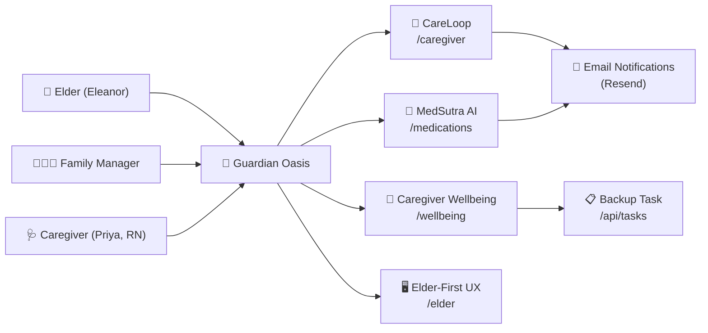
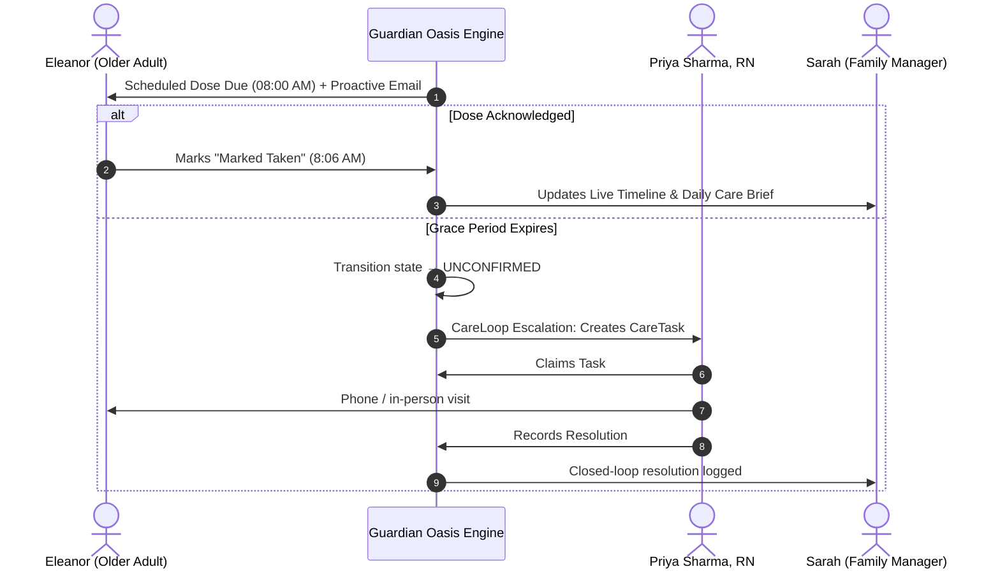

# 🍃 Guardian Oasis (CareOrbit)

> **PromptWars × Catalyst Hackathon** | Elderly Care & Medication Management Platform  
> *"Everything you need for clearer, calmer caregiving through one easy-to-use, intelligent dashboard."*

[]()
[-success)]()
[]()
[]()
[]()

---

## 🌟 Overview & Problem Alignment

Elderly healthcare management often fails not from a lack of medicine, but from **fragmented communication and unowned alerts**:
* **The Problem:** Reminder notifications get sent into noisy family group chats or dismissed accidentally. A caregiver assumes family handled it; family assumes the nurse handled it.
* **Our Solution:** **Guardian Oasis** transforms passive notifications into **CareLoop** — a closed-loop escalation and handoff engine. When a routine goes unacknowledged, Guardian Oasis doesn't spam everyone: it follows the elder's preferences, creates an owned follow-up task for the assigned caregiver, and records a permanent, timestamped resolution trail.

---

## 🚀 Quick Start

### 1. Clone & Install
```bash
git clone https://github.com/bhavesh-patil2007/catalyst-hackathon.git
cd "catalyst hackathon"
npm install && npm run dev
```

Open [http://localhost:3000](http://localhost:3000)

### 2. Build for Production
```bash
npm run build
```

### 3. Run Test Suite
```bash
npm test
```

### 4. Docker
```bash
docker build -t guardian-oasis .
docker run -p 3000:3000 guardian-oasis
```

---

## 🔐 Environment Variables

Copy `.env.example` to `.env.local` and fill in your values:

| Variable | Description | Required |
|---|---|---|
| `RESEND_API_KEY` | Resend API key for email sending | Optional (falls back to log-only) |
| `RESEND_FROM_EMAIL` | Sender email address | Optional |
| `NEXT_PUBLIC_APP_URL` | Public URL of the application | Optional |
| `IRON_SESSION_SECRET` | 32+ char secret for iron-session cookie encryption | Recommended |
| `GEMINI_API_KEY` | Google Gemini API key for MedSutra AI | Optional |

---

## 🏗️ Architecture Overview



---

## 📦 Module Descriptions

### 🔄 CareLoop — Closed-Loop Escalation Engine
The signature feature. When a dose check-in is not acknowledged within a configurable grace period, CareLoop automatically escalates to the assigned caregiver as an owned task. Caregivers claim, resolve, and log outcomes — creating a permanent audit trail with zero dropped tasks.

### 💊 MedSutra AI — Medication Safety Layer
AI-powered prescription review. Every medication change creates a versioned history (v1, v2, …) with author, timestamp, and clinical rationale. The Gemini API provides plain-language explanations and interaction checks. Human verification is required before any AI suggestion takes effect.

### 💚 Caregiver Wellbeing — Burnout Prevention
Daily mood/energy/sleep/stress check-ins for caregivers. Tracks 7-day trends, computes a burnout risk score (Low / Monitor / High), and surfaces a one-tap "Request Backup Caregiver" action when risk is high. Check-ins are private unless explicitly shared.

### 🖥️ Elder-First UX — Senior Calm View
Large 56px touch targets, Web Speech TTS narration, high-contrast toggle, font scaling, and plain-language status labels designed for adults 65+. Zero cognitive clutter.

---

## 🔌 API Endpoints

| Method | Path | Description |
|---|---|---|
| `GET` | `/api/care/today` | Today's medications and check-in status |
| `POST` | `/api/doses` | Mark a dose as taken / skipped / snoozed |
| `GET` | `/api/tasks` | List CareLoop tasks |
| `POST` | `/api/tasks` | Create a CareLoop task |
| `PATCH` | `/api/tasks/:id` | Update / resolve a task |
| `GET` | `/api/medications` | List medications |
| `POST` | `/api/medications` | Add a medication |
| `PATCH` | `/api/medications/:id` | Edit medication (creates versioned entry) |
| `GET` | `/api/appointments` | List appointments |
| `POST` | `/api/appointments` | Add appointment |
| `GET` | `/api/wellbeing/history` | Caregiver check-in history + burnout risk |
| `POST` | `/api/wellbeing/checkin` | Submit wellbeing check-in |
| `POST` | `/api/notifications/test-email` | Send a test notification email |
| `POST` | `/api/notifications/appointment-reminder` | Send appointment reminder |
| `POST` | `/api/auth/elder-pin` | Authenticate as elder (4-digit PIN) |
| `POST` | `/api/auth/circle-code` | Authenticate as family/caregiver |
| `POST` | `/api/auth/logout` | Destroy session |
| `GET` | `/api/auth/me` | Current session info |

---

## 👥 Three Dedicated Roles

1. **Older Adult (Eleanor Thompson, 76)**: Senior Calm View with TTS, large buttons, plain-language states.
2. **Family Manager (Sarah Thompson)**: Full dashboard, medication change guard, grounded daily care brief.
3. **Caregiver (Priya Sharma, RN)**: CareLoop task inbox, accountable handoffs, wellbeing check-ins.

---

## 🔄 The Signature Workflow: CareLoop



---

## 📋 Requirements Traceability Matrix

| Requirement | Implementation | Status |
|---|---|---|
| Medication reminder system | `/api/doses`, `/elder`, CareLoop escalation | ✅ Done |
| Closed-loop task handoff | `/api/tasks`, `/caregiver` CareLoop inbox | ✅ Done |
| Medication versioning | `/api/medications` (versioned history) | ✅ Done |
| Email notifications | `/api/notifications/test-email` (Resend) | ✅ Done |
| Appointment management | `/api/appointments`, `/appointments` | ✅ Done |
| Elder-First UX (large text, TTS) | `/elder`, Web Speech API, font scaling | ✅ Done |
| Role-based access | iron-session, 4-digit PIN, circle codes | ✅ Done |
| AI medication review | MedSutra AI (`/medsutra`) via Gemini API | ✅ Done |
| Caregiver wellbeing tracking | `/wellbeing`, `/api/wellbeing/*` | ✅ Done |
| Burnout risk detection | `wellbeingStore.getBurnoutRisk()` | ✅ Done |
| Backup caregiver request | `/api/tasks` BACKUP_REQUEST type | ✅ Done |
| Audit trail / timeline | `/timeline`, append-only event log | ✅ Done |
| Docker containerization | `Dockerfile`, `.dockerignore`, standalone output | ✅ Done |

---

## ✅ Hackathon Evaluation Criteria

- [x] **Problem-solution fit** — Addresses real fragmentation in elderly care coordination
- [x] **Technical execution** — Next.js 14 App Router, TypeScript, Zod validation, in-memory store
- [x] **AI integration** — MedSutra AI via Gemini API; grounded care brief (0 hallucination)
- [x] **Accessibility** — WCAG AAA elder-first design; TTS, high contrast, font scaling
- [x] **End-to-end workflow** — CareLoop escalation → claim → resolve → audit trail
- [x] **Testing** — 13/13 Vitest unit tests passing
- [x] **Documentation** — This README + ARCHITECTURE.md + SECURITY.md
- [x] **Deployability** — Docker multi-stage build, standalone output, env config

---

## 🧪 2-Minute Demo Script (For Judges)

1. **Home Portal (`/`)**: Select Older Adult Mode.
2. **Elder Screen (`/elder`)**: Click "Read Aloud" for TTS. Mark a dose "Taken".
3. **CareLoop (`/dashboard`)**: Trigger missed dose → see escalation task created.
4. **Caregiver Inbox (`/caregiver`)**: Claim task, log resolution note, close loop.
5. **Timeline (`/timeline`)**: View append-only audit trail.
6. **Wellbeing (`/wellbeing`)**: Submit a check-in; see burnout risk badge update.
7. **Email Bell**: Open notification drawer and dispatch a live email.

---

## 📄 License
MIT License. Built with passion for PromptWars × Catalyst Hackathon.
