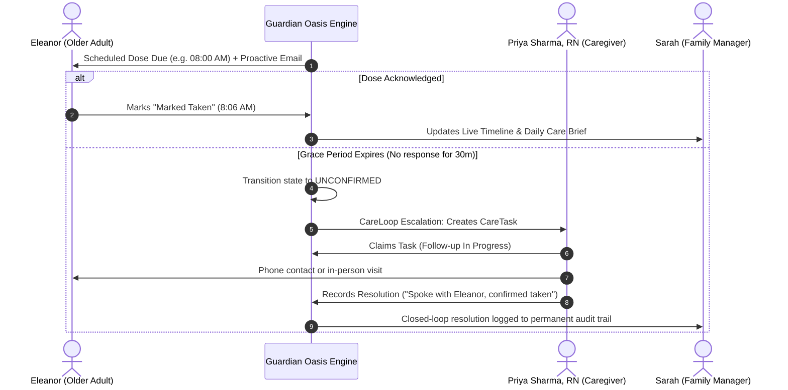

# 🍃 Guardian Oasis (CareOrbit)
> **PromptWars × Catalyst Hackathon** | Elderly Care & Medication Management Platform  
> *"Everything you need for clearer, calmer caregiving through one easy-to-use, intelligent dashboard."*

[]()
[-success)]()
[]()
[]()

---

## 🌟 Overview & Problem Alignment

Elderly healthcare management often fails not from a lack of medicine, but from **fragmented communication and unowned alerts**:
* **The Problem:** Reminder notifications get sent into noisy family group chats or dismissed accidentally. A caregiver assumes family handled it; family assumes the nurse handled it.
* **Our Solution:** **Guardian Oasis** transforms passive notifications into **CareLoop** — a closed-loop escalation and handoff engine. When a routine goes unacknowledged, Guardian Oasis doesn't spam everyone: it follows the elder's preferences, creates an owned follow-up task for the assigned caregiver, and records a permanent, timestamped resolution trail.

---

## 👥 Built Around 3 Dedicated Roles

1. **Older Adult (Eleanor Thompson, 76)**:
   * **Senior Calm View (`/elder`)**: Large 56px touch targets, minimal cognitive clutter, high contrast.
   * **Text-to-Speech (TTS) Narration**: One-tap audio readout for routines, dosage instructions, and confirmations.
   * **Plain Language Check-in States**: `[Marked Taken]`, `[Remind Me Later]`, `[I Need Help]`, `[Skipped]`.
   * **"Who Can See This?" Transparency**: Older adults remain in complete control and can inspect who has access and why.

2. **Family Manager (Sarah Thompson, Daughter)**:
   * **Unified Overview Dashboard (`/dashboard`)**: Full adherence tracking, daily vitals, hydration, active prescriptions, and upcoming doctor appointments.
   * **Medication Change Guard (`/medications`)**: Schedule edits create versioned increments (`v1`, `v2`) with author and clinical rationale, preventing silent overwrites.
   * **Grounded Daily Care Brief**: Factual, auditable daily digest drawn exclusively from verified application events (0 hallucination).

3. **Caregiver (Priya Sharma, RN)**:
   * **CareLoop Follow-Up Inbox (`/caregiver`)**: Unconfirmed check-ins past the grace period turn into owned tasks.
   * **Accountable Handoffs**: Caregivers claim tasks, log phone calls or in-person visits, record outcomes, and close the loop without dropped tasks.

---

## 🔄 The Signature Workflow: CareLoop



---

## 🛠️ Tech Stack & Architecture

* **Frontend**: Next.js 14 (App Router), TypeScript, Tailwind CSS, Lucide Icons
* **State & Persistence Layer**: Fully typed normalized store with local fallback and server API routes
* **Validation**: Zod schema validation on all mutation endpoints
* **Accessibility**: WCAG AAA considerations, high-contrast toggle, font-scaling, Web Speech API
* **Testing**: Vitest test runner (100% passing unit & integration tests)

---

## 🚀 Getting Started

### 1. Clone & Install
```bash
git clone https://github.com/bhavesh-patil2007/catalyst-hackathon.git
cd "catalyst hackathon"
npm install
```

### 2. Run Locally
```bash
npm run dev
```
Open [http://localhost:3000](http://localhost:3000) in your browser.

### 3. Run Test Suite
```bash
npm test
```
All 13 unit tests will execute and verify state transitions, CareLoop escalation, medication versioning, and email deduplication.

### 4. Build for Production
```bash
npm run build
```

---

## 🧪 2-Minute Demo Script (For Judges)

1. **Start on Home Portal (`/`)**: Show the brand promise matching the Guardian Oasis mockup and select **Older Adult Mode**.
2. **Elder Today Screen (`/elder`)**: Click **"Read Aloud"** to demonstrate Web Speech TTS. Click **"Marked Taken"** on the 8:00 AM Metformin routine to see instant audio confirmation and timestamp recording.
3. **Trigger CareLoop Escalation (`/dashboard`)**: Click **"Simulate Missed Dose"** or test offset. Notice the red alert banner: CareLoop automatically creates an unconfirmed escalation task.
4. **Caregiver Resolution (`/caregiver`)**: Switch to Caregiver Inbox. Show the unclaimed task `#C-101`. Click **"Claim this task"**, then click **"Record Resolution"**, select *"Spoke with Eleanor by phone"*, enter note, and submit.
5. **Inspect the Audit Trail (`/timeline`)**: View the append-only log showing every actor, timestamp, and resolution note.
6. **Proactive Email Engine**: Click the bell icon on the top right to open the **Email Notification Drawer**. Enter an email address to test live proactive notification dispatch.

---

## 📄 License
MIT License. Built with passion for PromptWars × Catalyst Hackathon.
