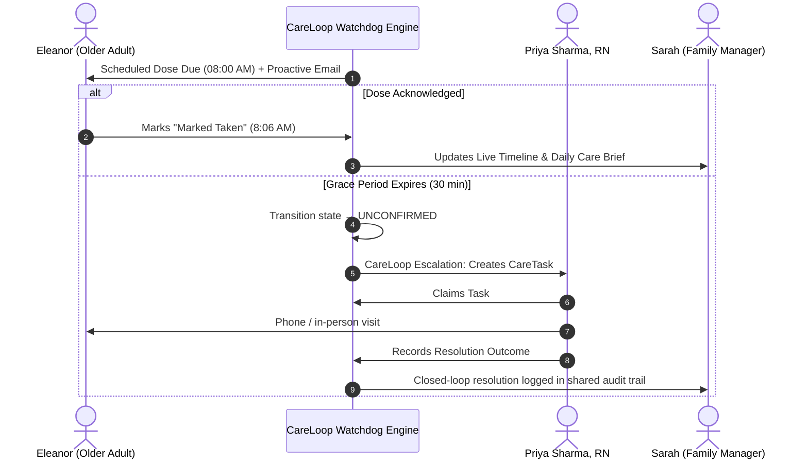

# 🍃 Guardian Oasis (CareOrbit)

> **PromptWars × Catalyst Hackathon** | Elderly Care & Medication Management Platform  
> *"Everything you need for clearer, calmer caregiving through one easy-to-use, intelligent dashboard."*

[]()
[-success)]()
[]()
[]()
[]()
[]()

---

## 🌟 Overview & Problem Alignment

Elderly healthcare management often fails not from a lack of medicine, but from **fragmented communication and unowned alerts**:
* **The Problem:** Reminder notifications get sent into noisy family group chats or dismissed accidentally. A caregiver assumes family handled it; family assumes the nurse handled it.
* **Our Solution:** **Guardian Oasis** transforms passive notifications into **CareLoop** — a closed-loop escalation and handoff engine. When a routine goes unacknowledged, Guardian Oasis doesn't spam everyone: it follows the elder's preferences, creates an owned follow-up task for the assigned caregiver, and records a permanent, timestamped resolution trail.

---

## 🚀 Quick Start

### 1. Clone & Install
```bash
git clone https://github.com/bhavesh-patil2007/catalyst-hackathon.git
cd "catalyst hackathon"
npm install && npm run dev
```

Open [http://localhost:3000](http://localhost:3000)

### 2. Build for Production
```bash
npm run build
```

### 3. Run Test Suite
```bash
npm test
```

### 4. Docker
```bash
docker build -t careorbit .
docker run -p 8080:8080 careorbit
```

---

## 🔐 Environment Variables

Copy `.env.example` to `.env.local` and configure your environment:

| Variable | Description | Required |
|---|---|---|
| `IRON_SESSION_SECRET` | 32+ character secret for encrypted session cookies | **Required in Production** |
| `SUPABASE_URL` | Supabase PostgreSQL project URL | **Required in Production** |
| `SUPABASE_SERVICE_ROLE_KEY` | Server-only Supabase service-role key | **Required in Production** |
| `DATABASE_URL` | Optional direct PostgreSQL connection string | Optional (fallback to Supabase client) |
| `CRON_SECRET` | Secret token for authorized Cloud Scheduler watchdog invocations | **Required for Cron** |
| `GEMINI_API_KEY` | Google Gemini API key for MedSutra AI prescription extraction | Optional (demo mode available) |
| `RESEND_API_KEY` | Resend API key for proactive email reminders | Optional (logs notification if unset) |
| `RESEND_FROM_EMAIL` | Sender email address for reminders | Optional |
| `NEXT_PUBLIC_APP_URL` | Public application URL | Optional |
| `NODE_ENV` | Environment mode (`development`, `test`, `production`) | Recommended |

---

## 👥 Authentication & Role-Based Access Control (RBAC)

CareOrbit features a dedicated, public login portal at `/login` with automated role-based redirection:

1. **Older Adult (Eleanor Thompson, 76)**:
   - **Login**: Authenticate with senior 4-digit PIN (`1234` in demo).
   - **Destination**: `/elder` — Senior Calm View with Web Speech TTS, 56px touch targets, high contrast, and plain-language status labels.
2. **Family Manager (Sarah Thompson)**:
   - **Login**: Authenticate with Family Circle code (`OASIS-7629`).
   - **Destination**: `/dashboard` — Patient overview, medication versioning, appointment scheduling, and care brief.
3. **Primary Caregiver (Priya Sharma, RN)**:
   - **Login**: Authenticate with Caregiver code (`CAREGIVER-4192`).
   - **Destination**: `/caregiver` — CareLoop task inbox, handoffs, and shift resolutions.
4. **Read-Only Observer**:
   - **Login**: Authenticate with Observer code (`OBSERVER-8301`).
   - **Destination**: `/timeline` — Read-only chronological audit log.

---

## 🏗️ Architecture & Database Persistence

CareOrbit implements a decoupled **Repository Pattern** (`src/lib/db/repository.ts`) with PostgreSQL schema migrations (`supabase/migrations/`):

- **Production Mode (`NODE_ENV=production`)**: Demands active database credentials (`SUPABASE_URL` + `SUPABASE_SERVICE_ROLE_KEY` or `DATABASE_URL`), failing closed to prevent data loss.
- **Demo / Test Mode**: Provides automatic in-memory fallback for local development and rapid evaluation without external credentials.
- **Security Boundary**: The Supabase service-role key is restricted to server-side repository operations (`src/lib/supabase/server.ts`) and is never leaked to client bundles.

---

## 🔌 API Endpoints

All sensitive care routes strictly verify server-side iron-session cookies and enforce patient-level isolation:

| Method | Path | Description | Access |
|---|---|---|---|
| `GET` | `/api/care/today` | Today's medications, occurrences, appointments, and brief | All circle members |
| `POST` | `/api/care/cron-watchdog` | Automated 30-min grace-period escalation and reminders | Bearer `CRON_SECRET` |
| `POST` | `/api/doses/checkin` | Record dose status (MARKED_TAKEN, SNOOZE, NOT_SURE, SKIPPED) | Owner, Family, Caregiver |
| `GET` | `/api/medications` | List active medications and version history | All circle members |
| `POST` | `/api/medications` | Create new medication order (prevents duplicate names) | Owner, Family Manager |
| `PATCH` | `/api/medications` | Edit medication with clinical version increment (v1 $\to$ v2) | Owner, Family Manager |
| `GET` | `/api/appointments` | List scheduled doctor appointments | All circle members |
| `POST` | `/api/appointments` | Schedule a new doctor consultation | Owner, Family Manager |
| `POST` | `/api/tasks` | CareLoop operations: claim, handoff, resolve, backup_request | Caregiver, Family Manager |
| `POST` | `/api/medsutra/extract` | Gemini Flash Vision prescription extraction with magic-byte checks | Owner, Family, Caregiver |
| `GET` | `/api/wellbeing/history` | Caregiver wellbeing history (filters unconsented records) | Caregiver (self), Family |
| `POST` | `/api/wellbeing/checkin` | Submit daily caregiver sleep, mood, stress, and energy check-in | Caregiver |
| `POST` | `/api/auth/elder-pin` | Authenticate senior via 4-digit PIN | Public |
| `POST` | `/api/auth/circle-code` | Authenticate circle member via server-derived invite code | Public |
| `POST` | `/api/auth/logout` | Destroy authenticated session cookie | Authenticated |
| `GET` | `/api/auth/me` | Retrieve current authenticated user role and identity | Authenticated |
| `GET` | `/api/health` | Service diagnostics and readiness probe | Public / Container Probe |

---

## 🔄 The Signature Workflow: CareLoop



---

## 🧪 Automated Test Suite (94 Tests Passing)

Execute the full suite of unit, security, timing, and end-to-end integration tests:
```bash
npm test
```

Coverage highlights:
* **`tests/api-security.test.ts` (28 tests)**: Route auth, client header forgery prevention, PHI masking, magic byte validation.
* **`tests/careloop-timing.test.ts` (8 tests)**: Controlled-clock watchdog evaluation, grace-period escalation, idempotency, repository persistence.
* **`tests/innovations.test.ts` (8 tests)**: MedSutra file validation, duplicate medication rejection, wellbeing privacy filtering.
* **`tests/e2e-workflows.test.ts` (16 tests)**: End-to-end user journeys from login to dose check-in, task handoff, and notification suppression.
* **`tests/guardian.test.ts` (22 tests)**: Core domain logic and store helpers.
* **`tests/security.test.ts` (7 tests)**: Passcode redaction and RBAC invariants.
* **`tests/smoke.test.ts` (4 tests)**: System smoke and basic flow tests.
* **`tests/careloop-workflow.test.ts` (1 test)**: Full lifecycle integration test.

---

## 📄 License
MIT License. Built for the PromptWars × Catalyst Hackathon.
